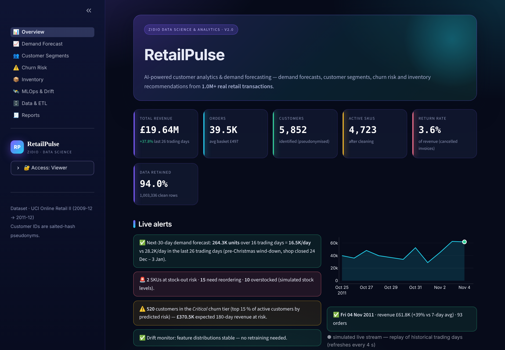
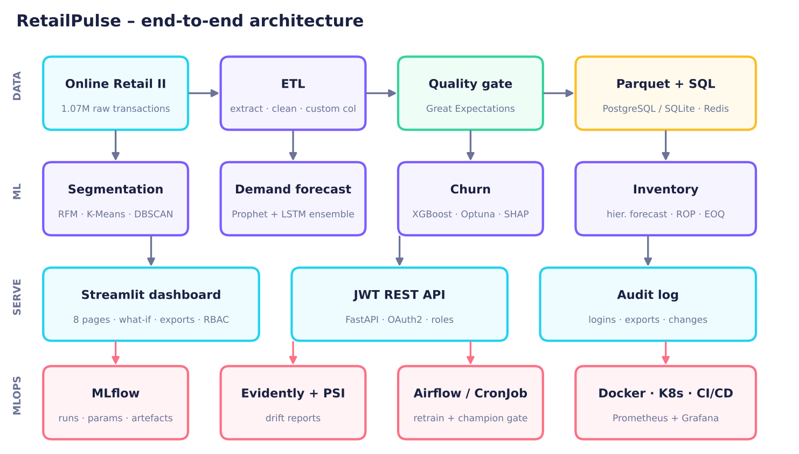
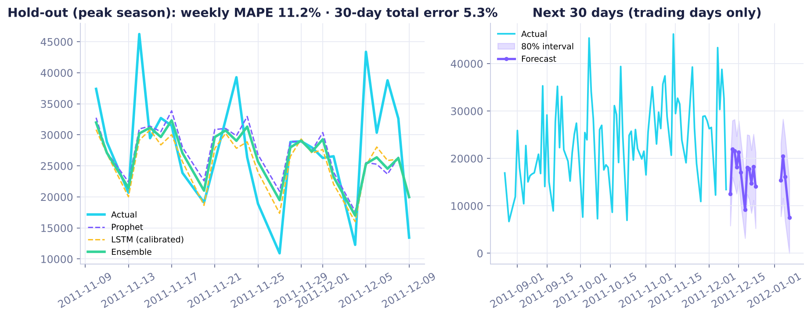
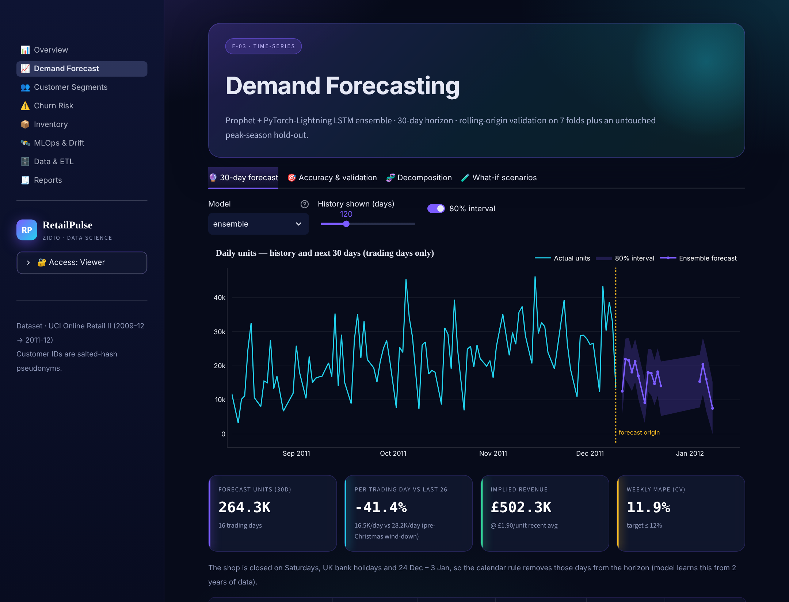
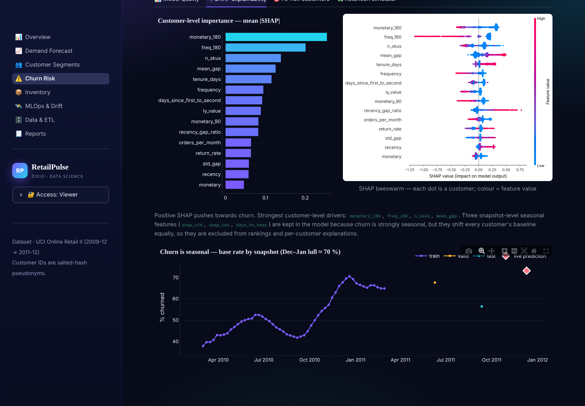
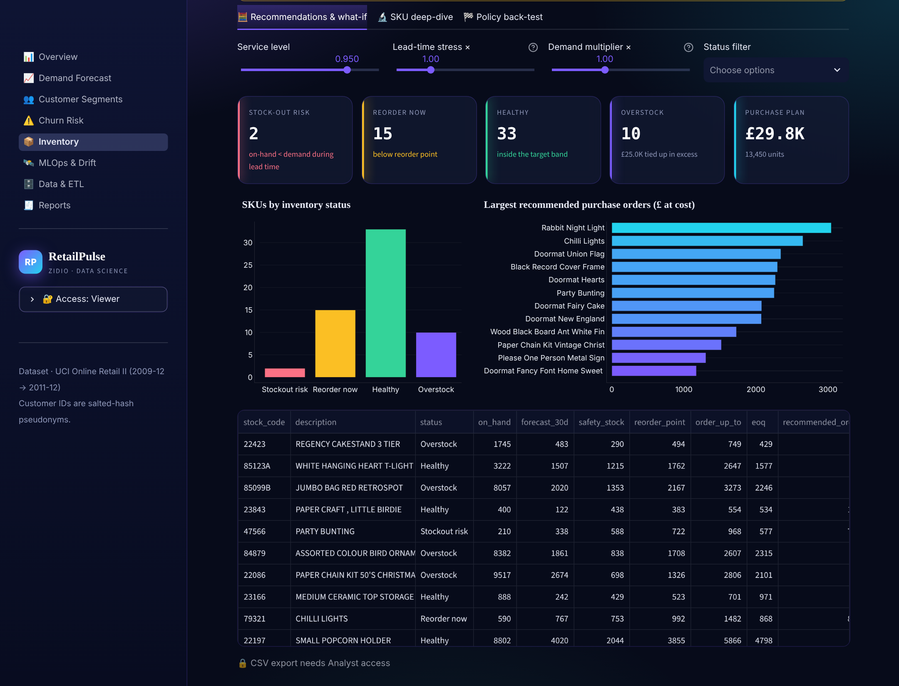
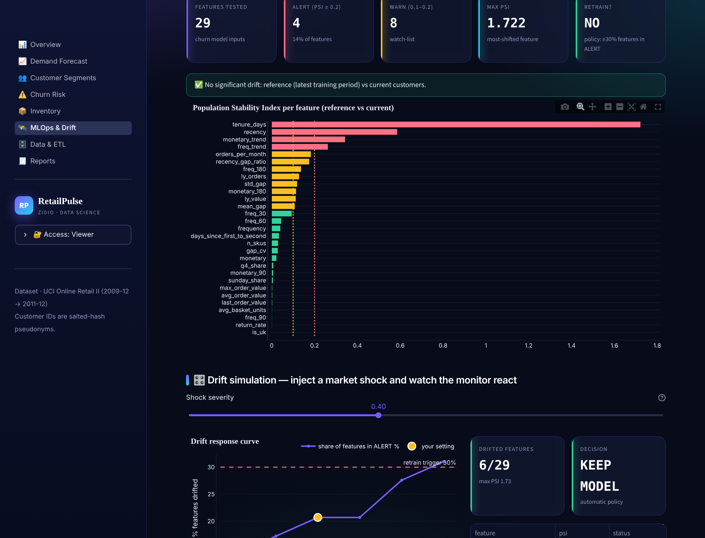

<div align="center">

# 📊 RetailPulse

### AI-Powered Customer Analytics & Demand Forecasting Platform

*Predictive demand • Customer segmentation • Churn analysis • Inventory optimisation*

    

**[🔴 Live demo](https://retailpulse-77wtccmydlnjaosuqdorjv.streamlit.app)** · **[📄 Project report (PDF)](https://drive.google.com/drive/folders/1CktH6fhtpEjAqZHLpW4jymXMZ-zzh_l4)** · **[🎬 Demo video](https://drive.google.com/drive/folders/1CktH6fhtpEjAqZHLpW4jymXMZ-zzh_l4)** · **[💻 GitHub](https://github.com/Janhavi-Amberkar/retailpulse)**

*Zidio Development · Data Science & Analytics · Author: Janhavi Prakash Amberkar · Mentor: Chandan Mishra · Nov 2026*



</div>

---

## 🔗 Project links (Zidio submission)

| Deliverable | Link |
|---|---|
| 💻 Source code (GitHub) | https://github.com/Janhavi-Amberkar/retailpulse |
| 🔴 Live deployment (Streamlit, public HTTPS) | https://retailpulse-77wtccmydlnjaosuqdorjv.streamlit.app |
| 🎬 Demo video (6 min, subtitled) | [Google Drive folder](https://drive.google.com/drive/folders/1CktH6fhtpEjAqZHLpW4jymXMZ-zzh_l4) → `RetailPulse_Demo_subtitled.mp4` |
| 📄 Project report (16-page PDF) | [Google Drive folder](https://drive.google.com/drive/folders/1CktH6fhtpEjAqZHLpW4jymXMZ-zzh_l4) → `RetailPulse_Report_Zidio_Nov2026.pdf` · also in [`docs/`](docs/RetailPulse_Report_Zidio_Nov2026.pdf) |
| 🎤 Feedback video | added to the same [Drive folder](https://drive.google.com/drive/folders/1CktH6fhtpEjAqZHLpW4jymXMZ-zzh_l4) |

Demo-role passcodes for the live app: Analyst `analyst` · Admin `admin` (Viewer needs no sign-in).

---

## 1. What it does

RetailPulse turns **1.07 M real retail transactions** (UCI *Online Retail II*, UK gift retailer, Dec 2009 → Dec 2011) into four business decisions, served through an 8-page Streamlit dashboard and a JWT-secured API:

| | Decision | Method | Headline result (measured) |
|---|---|---|---|
| **F-01** | Clean, trustworthy data | Automated ETL + Great Expectations gate, custom column `region_group` | 1,067,371 → 1,003,336 rows · **27/27** quality checks |
| **F-02** | *Who are our customers?* | RFM + behavioural features → K-Means (k by silhouette, 6–8) · DBSCAN check | **6 segments**; top segment = 73 % of revenue |
| **F-03** | *How much will sell?* | Prophet + PyTorch-Lightning LSTM calibrated ensemble, 30-day horizon | weekly MAPE **11.9 %** (CV) / **11.2 %** (hold-out) · 30-day total error **4.2 % / 5.3 %** |
| **F-04** | *Who is leaving?* | XGBoost + Optuna (vs LR, RF) + SHAP, out-of-time test | AUC **0.806** · precision@top-20 % **0.889** (lift 1.57×) |
| **F-05** | *What should we reorder?* | Hierarchical SKU forecast → safety stock, ROP, EOQ; back-test on real demand | total cost **−10.5 %** vs best baseline, **−56 %** vs naive; fill rate 87.4 % |
| **F-06** | Self-service analytics | Streamlit, what-if analysis, CSV/PDF export, RBAC, audit log | 8 pages · live drift simulator |

### Spec scoreboard — measured, not claimed

| Target (Zidio brief) | Result | Status |
|---|---|---|
| Forecast MAPE ≤ 12 % (30-day ahead) | **weekly** 11.9 % CV / 11.2 % hold-out · **daily** 30.9 % CV / 19.5 % hold-out | ✅ weekly · ❌ daily |
| Churn AUC-ROC ≥ 0.88 | 0.806 (strict out-of-time test) | ❌ not met |
| Churn precision@top-20 % ≥ 0.75 | 0.889 | ✅ |
| 6–8 segments with business meaning | 6 | ✅ |
| Reduce over/under-stock 25–40 % | cost −10.5 % / −56 % vs baselines; **but** total over+under units not reduced vs the safety-stock baseline | ⚠️ partially |
| Daily batch < 5 min, 10 M+ tx/month | ETL + aggregation: 3.2 M rows in 7.3 s → ≈ 23 s for 10 M (extrapolated) | ✅ |
| MLflow tracking + drift detection | MLflow runs, Evidently reports, PSI/KS, retraining policy | ✅ |

> **Why the misses?** Daily unit totals are dominated by a handful of wholesale orders, so *daily* MAPE is high for every model (naive baseline: 31.7 %); the target is met at the weekly horizon that drives replenishment. The churn AUC is measured with a time-based split on two years of data (random splits would show a higher, misleading number). The report (§6) discusses both honestly.

> **Transparency note:** the public dataset has **no stock table**. Demand, forecasts, safety stock, ROP, EOQ and the policy back-test use real sales; the *current on-hand stock and supplier lead times are simulated* (seeded, labelled `synthetic` everywhere).

## 2. Quick start

```bash
git clone https://github.com/<your-user>/retailpulse.git && cd retailpulse
pip install -r requirements.txt          # light: enough to run the dashboard (artefacts are committed)
streamlit run app/streamlit_app.py       # → http://localhost:8501
```

Reproduce everything from the raw data (≈ 10 min on 2 CPU cores):

```bash
pip install -r requirements-ml.txt       # prophet, torch, lightning, xgboost, shap, optuna, mlflow, evidently, ...
make data        # downloads the 95 MB public CSV (not stored in git)
make pipeline    # ETL → segmentation → forecast → churn → inventory → drift → load test (+ MLflow)
make test        # 39 tests (ETL rules, leakage guards, calendar, inventory maths, API/RBAC, dashboard)
mlflow ui --backend-store-uri sqlite:///mlflow.db
```

Roles (sidebar → *Access*): **Viewer** (default, no sign-up) · **Analyst** passcode `analyst` · **Admin** passcode `admin` — demo defaults, override with `ANALYST_PIN` / `ADMIN_PIN` secrets.

## 3. Architecture

```
raw CSV ─► ETL (extract ▸ clean ▸ anonymise ▸ +region_group) ─► Great-Expectations gate ─► Parquet / PostgreSQL
                                                                         │
   ┌──────────────┬─────────────────────────┬───────────────────────────┴──────────────┐
segmentation   forecasting (Prophet+LSTM)   churn (XGBoost+SHAP)      inventory (hierarchical forecast → ROP/EOQ)
   └──────────────┴────────────┬────────────┴──────────────────────────────────────────┘
        MLflow tracking ◄──────┤──────► Streamlit dashboard · JWT API · PDF/CSV export · audit log
    Evidently / PSI drift ◄────┘        Prometheus ▸ Grafana · Airflow / CronJob retrain ▸ champion–challenger gate
```



## 4. Repository layout

```
├── app/                    Streamlit app (router + 8 pages) and shared UI/theme/RBAC layer
├── api/main.py             FastAPI, OAuth2 password flow, JWT (HS256), role-based endpoints
├── src/retailpulse/
│   ├── etl/                extract · transform · validate (Great Expectations) · load · pipeline
│   ├── features.py         RFM + churn snapshots (leakage-safe, time-based split)
│   ├── segmentation.py     K-Means / DBSCAN + business naming
│   ├── forecasting.py      Prophet, PyTorch-Lightning LSTM, trading calendar, ensemble, metrics
│   ├── churn.py            XGBoost + Optuna + SHAP, benchmark models
│   ├── inventory.py        hierarchical SKU forecast, safety stock, ROP, EOQ, policy back-test
│   ├── drift.py            PSI / KS / Evidently, retrain policy      monitoring.py  Prometheus + audit log
│   └── train.py            orchestrator with MLflow tracking          reporting.py   executive PDF
├── scripts/                retrain.py (champion/challenger) · make_figures · build_notebooks · build_report · ...
├── airflow/dags/           retailpulse_retrain.py            k8s/  Deployment, Service, Ingress, HPA, CronJob
├── monitoring/             Prometheus config + alert rules, Grafana dashboard    Dockerfile · docker-compose.yml
├── notebooks/              01_EDA.ipynb · 02_Model_Results.ipynb (executed)      tests/  39 tests
├── data/processed/         compact artefacts the dashboard reads (raw CSV is git-ignored)
├── models/ reports/ docs/  small models · metrics JSON + figures · report PDF, deployment guide, demo scripts
└── .github/workflows/      CI (lint → test → smoke → image) and optional Cloud Run deploy
```

## 5. Data & ETL

* **Source:** [UCI Online Retail II](https://archive.ics.uci.edu/dataset/502/online+retail+ii) — real UK online gift retailer, many wholesale customers (CC BY 4.0, Chen 2012).
* **Cleaning (lineage in `reports/etl_report.json`, charted in the dashboard):** exact duplicates (34,335) · cancellations split into a returns table (19,104) · bad-debt adjustments · qty ≤ 0 / price ≤ 0 (6,014) · non-product service codes `POST`, `DOT`, `M`, `BANK CHARGES`… (4,574) · description back-fill · duplicates exposed by normalisation · quantity winsorised at p99.9 · customer IDs → salted SHA-256 pseudonyms.
* **Custom column:** `region_group` (UK / Europe / Rest of World / Unspecified) derived from `country`, used for regional trends and filters.
* **Quality gate:** 27 checks (nulls, ranges, revenue arithmetic, allowed sets, anonymisation pattern, no duplicates…) via Great Expectations + pandas; the pipeline **fails** if any check fails (it caught a real duplicate issue during development).

## 6. Modelling notes

* **Forecast:** target = daily winsorised units on *trading days* (shop is closed on Saturdays, UK bank holidays and 24 Dec–3 Jan). 7 rolling-origin folds for tuning + an untouched peak-season hold-out. LSTM bias-calibration factor and ensemble weight are fitted on CV folds only. ADF/KPSS/STL diagnostics are in the dashboard.
* **Churn:** churn = no purchase in the next 90 days. Weekly snapshots for training (Mar-2010→Feb-2011), a validation snapshot, and a test snapshot at the end of the data; label windows never overlap later snapshots and features use only earlier data (unit test is mutation-verified). Seasonal snapshot features calibrate the baseline but are excluded from explanations; risk tiers are rank-based.
* **Inventory:** per-SKU Prophet intervals were unstable (first back-test showed 535 % overstock), so SKU forecasts are *hierarchical* (SKU share × business-level Prophet). Median 4-week per-SKU WAPE: moving average 51 %, per-SKU Prophet 72 %, hierarchical 54 % — the gain comes from uncertainty-aware buffers rather than sharper point forecasts.



## 7. MLOps, security & operations

| Area | Implementation |
|---|---|
| Experiment tracking | MLflow (SQLite) – every stage logs params/metrics/artefacts; run table shown in the dashboard |
| Drift | PSI + KS per feature and Evidently AI HTML reports; **live drift simulator** in the dashboard; policy: ≥30 % features PSI ≥ 0.2 *or* weekly MAPE +25 % *or* AUC −0.03 |
| Retraining | `scripts/retrain.py` / Airflow DAG / K8s CronJob → champion–challenger gate with automatic roll-back |
| Monitoring | Prometheus metrics endpoint, alert rules, provisioned Grafana dashboard |
| CI/CD | GitHub Actions: ruff + black → pytest (+coverage) → dashboard smoke test → multi-stage Docker build (GHCR); optional Cloud Run deploy |
| Security & privacy | pseudonymised IDs · Viewer/Analyst/Admin RBAC · JWT API (PBKDF2 users, 1 h tokens) · audit log of logins / failures / exports · no secrets in git |

## 8. Screenshots

| | |
|---|---|
|  |  |
|  |  |

## 9. Deploy

See [`docs/DEPLOYMENT.md`](docs/DEPLOYMENT.md) — Streamlit Community Cloud (3 min, main file `app/streamlit_app.py`), Hugging Face Spaces, Docker, Kubernetes, Cloud Run.

## 10. Limitations & next steps

* Inventory stock levels / lead times are simulated; connect a real ERP feed.
* Price elasticity and promo uplift in the what-if tool are user assumptions (no promo/price experiments in the data).
* Two years of history give one prior Christmas to learn from; more history should lift both forecast and churn quality.
* Next: probabilistic (quantile) forecasts, survival-analysis churn, uplift-based win-back targeting, online drift monitoring on the API.

---
*Dataset © Daqing Chen, UCI ML Repository, CC BY 4.0. Code: MIT.*
